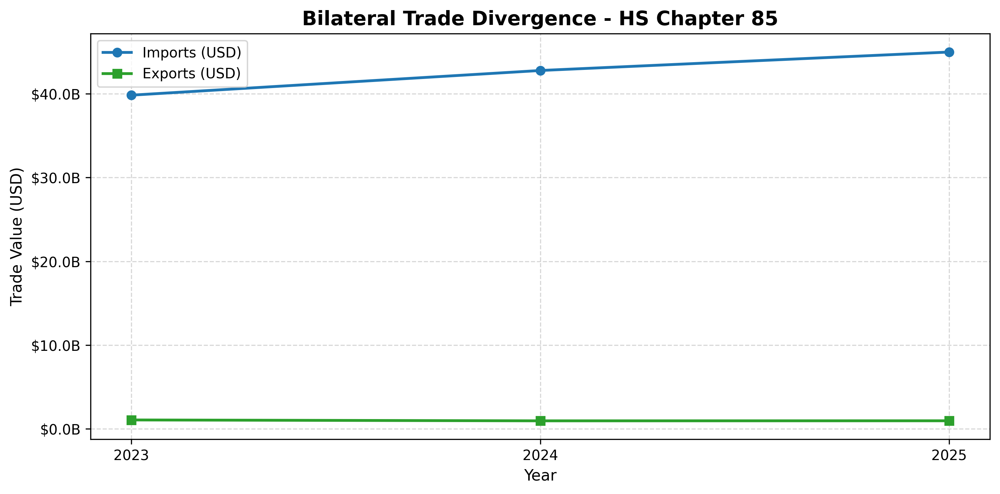

# Quantitative Audit of Bilateral Trade Asymmetries: China & Mexico (2023–2025)

An applied economic and quantitative trade audit evaluating bilateral trade flows, structural asymmetries, and coverage deficits between **China and Mexico** across the 2023–2025 period. Utilizing official **UN Comtrade** data, this project combines **Pandas** and in-memory analytical SQL via **DuckDB** to examine structural dependency across strategic Harmonized System (HS) chapters within the context of North American nearshoring.

---

## Executive Quantitative Summary (2023–2025 Consolidated)

Auditing the bilateral exchange across the three focal chapters revealed an aggregate **trade deficit of -\$199.03 Billion USD** against Mexico, with an overall **Asymmetry Ratio of 45.08 to 1**.

* **Total Mexican Imports from China:** **\$203,546,215,288 USD** (~\$203.55B)
* **Total Mexican Exports to China:** **\$4,515,367,091 USD** (~\$4.52B)
* **Net Bilateral Trade Deficit:** **-\$199,030,848,197 USD** (~-\$199.03B)
* **Global Coverage Ratio:** **2.22%** *(Mexican exports cover only 2.22% of imported value)*
* **Normalized Trade Balance Index ($NBI$):** **-0.9566** *(Scale from -1 to +1, where -1 represents absolute import dependency)*

---

## Consolidated Breakdown by HS Chapter (2023–2025)

| HS Chapter | Sector Description | Total Imports (USD) | Total Exports (USD) | Net Trade Deficit (USD) | Asymmetry Ratio | Coverage (%) | NBI |
| :---: | :--- | :---: | :---: | :---: | :---: | :---: | :---: |
| **85** | **Electronics & Electrical Machinery** | \$127,576,541,361 | \$3,007,409,374 | **-\$124,569,131,987** | **42.42 : 1** | 2.36% | -0.9539 |
| **84** | **Industrial Machinery & Boilers** | \$73,700,478,553 | \$1,506,249,508 | **-\$72,194,229,045** | **48.93 : 1** | 2.04% | -0.9599 |
| **64** | **Footwear & Related Accessories** | \$2,269,195,374 | \$1,708,209 | **-\$2,267,487,165** | **1,328.41 : 1** | **0.08%** | **-0.9985** |

---

## Visualizing Bilateral Trade Divergence (HS Chapter 85)

Chapter 85 (Electronics and Electrical Components) represents the largest absolute monetary imbalance in bilateral trade. While Mexican exports have stagnated below \$1.1B USD annually, Chinese imports grew from \$39.83B in 2023 to \$44.97B in 2025.

---

## Annual Detailed Audit (Year-by-Year Evolution)

| HS Chapter | Year | Mexican Exports (USD) | Mexican Imports (USD) | Trade Balance (USD) | Asymmetry Ratio | Coverage (%) | NBI |
| :---: | :---: | :---: | :---: | :---: | :---: | :---: | :---: |
| **64** | 2023 | \$983,645 | \$765,147,704 | -\$764,164,059 | **777.87 : 1** | 0.13% | -0.9974 |
| **64** | 2024 | \$543,169 | \$897,272,662 | -\$896,729,493 | **1,651.92 : 1** | 0.06% | -0.9988 |
| **64** | 2025 | \$181,395 | \$606,775,008 | -\$606,593,613 | **3,345.05 : 1** | **0.03%** | **-0.9994** |
| **84** | 2023 | \$551,449,072 | \$21,701,094,738 | -\$21,149,645,666 | **39.35 : 1** | 2.54% | -0.9504 |
| **84** | 2024 | \$498,926,899 | \$25,357,616,143 | -\$24,858,689,244 | **50.82 : 1** | 1.97% | -0.9614 |
| **84** | 2025 | \$455,873,537 | \$26,641,767,672 | -\$26,185,894,135 | **58.44 : 1** | 1.71% | -0.9664 |
| **85** | 2023 | \$1,070,976,209 | \$39,829,628,491 | -\$38,758,652,282 | **37.19 : 1** | 2.69% | -0.9476 |
| **85** | 2024 | \$965,094,873 | \$42,772,511,870 | -\$41,807,416,997 | **44.32 : 1** | 2.26% | -0.9559 |
| **85** | 2025 | \$971,338,292 | \$44,974,401,000 | **-\$44,003,062,708** | **46.30 : 1** | 2.16% | -0.9577 |

---

## Core Economic & Strategic Insights

### 1. Absolute Capital Leakage (Chapters 84 & 85: ~\$196.76B USD Deficit)
* **The Global Value Chain Mechanism:** In electronics and machinery, Mexico acts primarily as an advanced assembly and manufacturing bridge toward North America under USMCA (T-MEC).
* **Structural Dependency:** The continuous rise in imports of capital goods (Ch. 84) and intermediate technological components (Ch. 85) demonstrates that while manufacturing capacity is expanding in Mexico due to nearshoring, the core technological supply chain remains heavily reliant on Asian inputs.

### 2. Extreme Relative Asymmetry (Chapter 64: Footwear)
* While Chapter 64 accounts for a smaller monetary deficit (-\$2.27B USD), it displays the most acute structural collapse: in 2025, Mexico imported **\$3,345.05 USD for every \$1 USD exported** to China, with exports collapsing to just \$181,395 USD.
* This highlights the vulnerability of traditional domestic manufacturing sectors and underlines historical customs enforcement challenges (anti-dumping tariffs and reference pricing).

---

## Applied Econometric & Analytical Formulas

1. **Trade Coverage Ratio ($TCR$):**
   $$TCR = \left( \frac{\text{Exports}}{\text{Imports}} \right) \times 100$$
2. **Normalized Balance Index ($NBI$):**
   $$NBI = \frac{\text{Exports} - \text{Imports}}{\text{Exports} + \text{Imports}} \quad \in [-1, 1]$$
3. **Asymmetry Ratio ($AR$):**
   $$AR = \frac{\text{Imports}}{\text{Exports}}$$

---

## Project Structure

~~~text
├── 01_china_mexico_trade_asymmetry_audit.ipynb  # Main Audit Notebook (DuckDB + Pandas)
├── comtrade_china_mexico.csv                    # Official UN Comtrade bilateral dataset
├── trade_divergence_ch85.png                    # High-resolution time-series plot
├── requirements.txt                             # Reproducible environment dependencies
└── README.md                                    # Executive economic report
~~~

---

## Reproducibility & Setup

~~~bash
# 1. Clone repository
git clone https://github.com/luisferdm6/03-china-mexico-trade-audit.git
cd 03-china-mexico-trade-audit

# 2. Setup virtual environment
python -m venv venv
source venv/bin/activate  # On Windows: venv\Scripts\activate

# 3. Install tested dependencies
pip install -r requirements.txt

# 4. Launch Jupyter
jupyter notebook
~~~
